<a href="https://gabrielnovo.site" target="_blank" rel="noopener noreferrer">
  <picture>
    <source media="(prefers-color-scheme: dark)" srcset="./assets/hero-dark.svg" />
    <source media="(prefers-color-scheme: light)" srcset="./assets/hero-light.svg" />
    
  </picture>
</a>

  <a href="https://gabrielnovo.site"><strong>gabrielnovo.site</strong></a>
  &nbsp;&nbsp;·&nbsp;&nbsp;
  <a href="https://gabrielnovo.site/curriculo.pdf">Resume (PDF)</a>
  &nbsp;&nbsp;·&nbsp;&nbsp;
  <a href="https://www.linkedin.com/in/gabrielnovo-ia">LinkedIn</a>
  &nbsp;&nbsp;·&nbsp;&nbsp;
  <a href="https://nov.ia.br">Nov.IA (Founder)</a>

---

### Selected Production Work

Most of my commercial work runs in private repositories. Full architecture notes, case studies, and contact details live on **[gabrielnovo.site](https://gabrielnovo.site)**.

- **Operational ERP & CRM** — *React 18 · TypeScript · PostgreSQL · Supabase*  
  Designed the relational model with PostgreSQL Row-Level Security (RLS) across 6 hierarchical access tiers, backed by PL/pgSQL trigger-enforced state transitions for immutable audit trails and concurrency safety.

- **Autonomous Booking & Checkout Engine** — *Node.js · NestJS · Meta Cloud API · OpenAI API*  
  Built asynchronous webhook orchestration linking the official WhatsApp Business API, external quoting APIs, and native payment gateways into a single transactional flow.

- **[Nov.IA](https://nov.ia.br) — Founder** — *Process Automation & Custom Internal Tools*  
  Founded a technical consultancy in Curitiba focused on replacing manual spreadsheet routines with tested, monitored integrations and purpose-built software.

---

### Core Stack

| Layer | Technologies |
| :--- | :--- |
| **Backend & APIs** | TypeScript, Node.js, NestJS, REST APIs, Webhooks, Python |
| **Frontend** | React, Next.js, Vue.js, Tailwind CSS, Vite |
| **Data & Infra** | PostgreSQL (RLS, PL/pgSQL), Supabase, MySQL, Docker, GitHub Actions, Vercel, n8n |

---

<strong>CS Fundamentals &amp; Coursework (Public Repositories)</strong> — <em>not my day-to-day focus, kept here as verifiable engineering fundamentals</em>

 

My day-to-day work is commercial full-stack engineering (TypeScript, Node.js, React, PostgreSQL). The public repositories below come from my Systems Analysis and Development (ADS) coursework at Universidade Positivo — written with strict compiler flags, memory sanitizers, normalized schemas, automated tests, and CI to show command of core CS concepts.

| Repository | Domain | Engineering Highlights | CI |
| :--- | :--- | :--- | :---: |
| [`ads-modelagem-bd-vetcare`](https://github.com/cgn2222/ads-modelagem-bd-vetcare) | Relational Modeling (MySQL 8.0) | 16 normalized tables (3NF), constraints, views, transactional stored procedure, Docker |  |
| [`ads-algoritmos-sistema-bancario`](https://github.com/cgn2222/ads-algoritmos-sistema-bancario) | Domain Logic & Memory Safety (C11) | Exact integer currency math (`int64_t` cents), overflow guards, in-memory ledger, ASan/UBSan |  |
| [`ads-algoritmos-bilheteria-cinema`](https://github.com/cgn2222/ads-algoritmos-bilheteria-cinema) | Matrices & Memory Layout (C11) | Row-major matrix traversal, ISO C11 const-correctness, exact aggregations, ASan/UBSan |  |
| [`ads-algoritmos-bubble-sort`](https://github.com/cgn2222/ads-algoritmos-bubble-sort) | Algorithms & Complexity (C11) | Early-exit `O(n)` best case, instrumented comparisons/swaps, empirical stability proof |  |
| [`ads-algoritmos-cesta-basica`](https://github.com/cgn2222/ads-algoritmos-cesta-basica) | Structured Logic & CLI (C11) | Pseudocode, flowcharts, modular C11 implementation, safe input parsing, unit + E2E tests |  |

